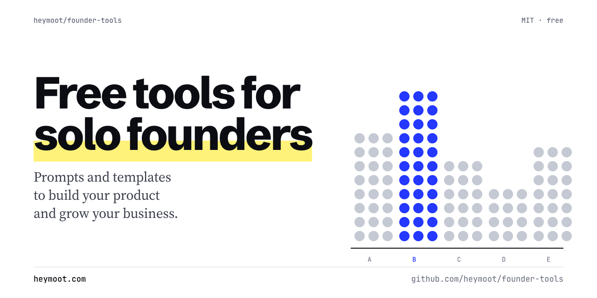

# heymoot founder tools

Free AI prompts and templates for solo founders: build your product and grow your business. Made by [heymoot.com](https://heymoot.com).

## Tools

### Find customers

| Tool | What it does | Runs in |
|---|---|---|
| [X Prospect Research](x-prospect-research/) | Finds potential customers in your competitors' engaged audience on X (Twitter) and turns them into an interactive report with a shortlist to check by hand. | Grok |

More tools for building product and growing your business are on the way.

## How the tools work

- **Paste a prompt.** Each tool is a prompt for an AI assistant. Its README says which assistant it needs and why.
- **Templates hold the design.** Each prompt links to its template, and the AI fills in only the data, so the result looks the same every time.
- **Open in a browser.** Each result is one HTML file. Nothing to install and no account needed.

Every tool folder has a README, the prompt, the template, and example output with fake data.

## About heymoot

[heymoot](https://heymoot.com) helps founders grow on X by talking to the right people every day, in their own words. These tools come from the work we do to build and grow heymoot, shared for free.

## License

[MIT](LICENSE). Use, change and share these tools freely, including in commercial work.
