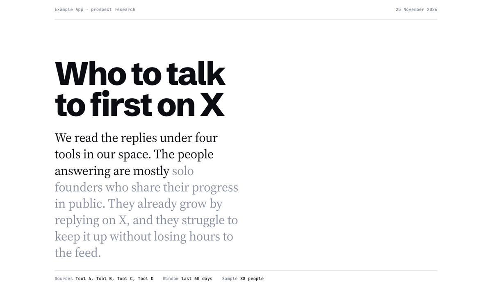
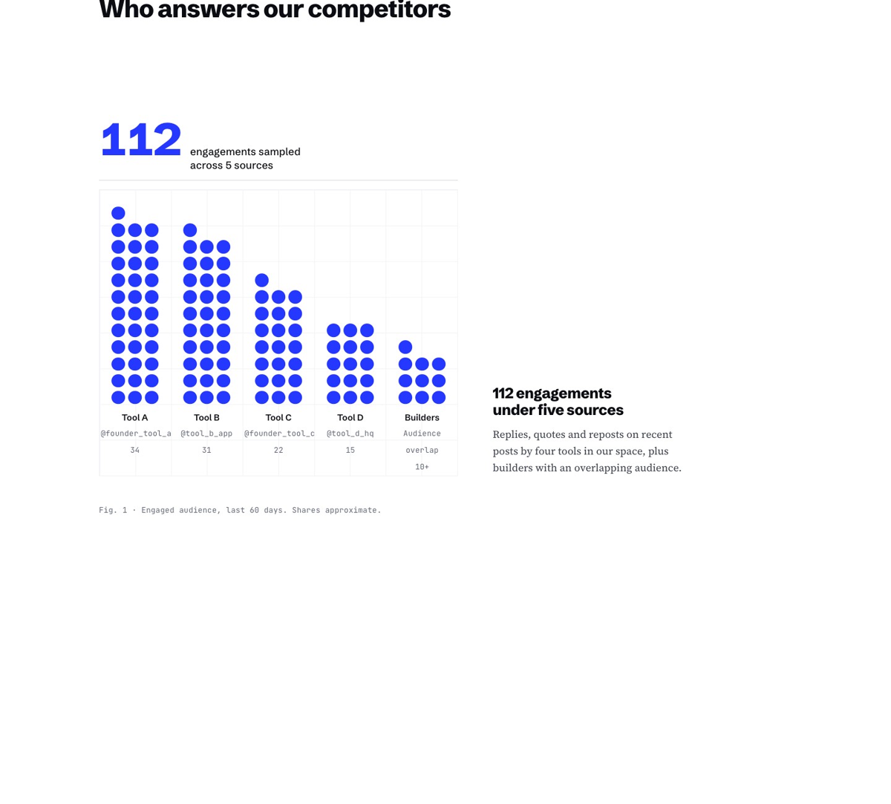
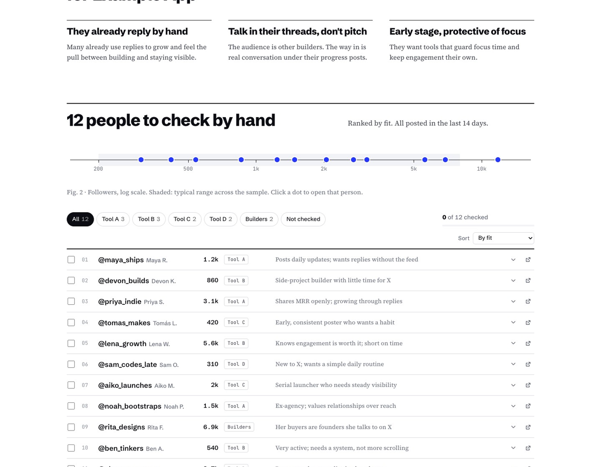

# X Prospect Research: find customers in your competitors' audience on X

A free Grok prompt and report design that turns your competitors' X (Twitter) audience into a short list of people worth talking to. Made by [heymoot](https://heymoot.com).

## What you get

One page you open in your browser, built from a live search of X:

- **Who answers your competitors.** A scroll-driven figure: every reply, quote and repost on your competitors' recent posts, then the unique people behind them, by role and by how recently they posted.
- **What fills their timeline.** Their top 8 topics and what they read and use.
- **Three findings** you can act on before you reach out.
- **Up to 20 people to check by hand**, ranked by fit, each with the post that shows they care. Tick people off as you go.

[`example.html`](example.html) is a report with **fake example data**. None of the people or accounts are real, and its links go to example.com.

## How to use it

1. Open [Grok](https://grok.com). It's the assistant that can search X live, which this tool needs.
2. Copy the prompt from [`prompt.md`](prompt.md), replace `[your website]`, and send it.
3. Save the HTML Grok returns as `report.html` and open it in your browser. It needs an internet connection to load the design.

## Why the engaged audience

X follower lists can't be searched, and most followers are inactive. People who replied to, quoted or reposted a competitor in the last 60 days are active, and they care about the problem. That makes them the best place to start talking.

## Check before you trust it

Grok can still get things wrong. Open each profile before you reach out: the prompt asks for checked handles and real post links, but a quick look takes a minute and saves an awkward reply.

## Customize

Grok writes only the data (`window.DATA`). The design lives in [`report.js`](report.js), which every report loads from jsDelivr, so Grok can't break the layout. To change a report, edit its data. To change the design, fork the repo and point the script tag at your copy of `report.js`.

---

Built by [heymoot](https://heymoot.com), which helps founders grow on X by talking to the right people every day, in their own words. More free tools for founders: [heymoot/founder-tools](../README.md).
